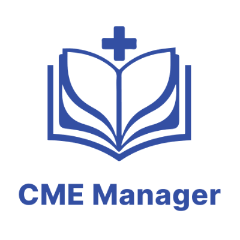

<p align="center">
  
</p>

<h1 align="center">CME Manager — Gemini CLI Extension</h1>

<p align="center">
  <strong>Trợ lý AI Quản lý Hội nghị Y khoa & Đào tạo Y khoa Liên tục (CME) trên Gemini CLI</strong>
</p>

<p align="center">
  
  
  
  
</p>

---

## 📖 Giới thiệu

**`cme-gemini-extension`** là extension chính thức dành cho **Google Gemini CLI**, cho phép các nhà quản lý y tế, bác sĩ, điều phối viên hội nghị và cán bộ quản lý đào tạo tương tác trực tiếp với nền tảng **CME Manager** bằng ngôn ngữ tự nhiên thông qua giao thức **Model Context Protocol (MCP)**.

Với hơn **93 công cụ nghiệp vụ y tế chuyên sâu**, extension hỗ trợ toàn diện từ khâu tra cứu thông tin, đọc tài liệu chương trình (PDF, Word, Excel, hình ảnh) để tạo bản nháp hội nghị, quản lý báo cáo viên/giảng viên, điều phối thực hành lâm sàng, xuất báo cáo và tạo mã QR/khảo sát.

---

## ✨ Tính năng Nổi bật

* 🏥 **Quản trị Hội nghị Khoa học:** Tra cứu hội nghị, tự động trích xuất lịch trình từ tài liệu đính kèm để tạo hội nghị nháp, quản lý phiên họp, bài báo cáo và phân công báo cáo viên.
* 🎓 **Quản lý Đào tạo Y khoa Liên tục (CME):** Quản lý chương trình đào tạo, khóa học, bài giảng, lớp học và điều kiện cấp chứng chỉ CME.
* 🩺 **Điều phối Thực hành Lâm sàng:** Theo dõi lịch thực hành của sinh viên y khoa tại các bệnh viện/cơ sở đào tạo, tra cứu bảng kiểm chỉ tiêu tay nghề và bác sĩ hướng dẫn.
* 📊 **Báo cáo & Thống kê Thời gian thực:** Thống kê lượt tham dự, điểm danh check-in/checkout, xuất báo cáo tài chính và danh sách đại biểu/học viên.
* 🎨 **Truyền thông & Khảo sát:** Sinh phôi banner hội nghị theo đúng kích thước chuẩn chuyên khoa y tế; tạo link biểu mẫu đăng ký, form khảo sát sau hội nghị.
* 🛡️ **Cơ chế An toàn Draft-Only:** Mọi dữ liệu do AI tạo mới hoặc sửa đổi luôn ở trạng thái **Bản nháp (Draft)**, không tự ý công khai hay xóa dữ liệu. Quản trị viên luôn là người kiểm duyệt cuối cùng trên Web CMS.

---

## 📋 Yêu cầu Tiên quyết

1. Đã cài đặt **Gemini CLI** (Công cụ dòng lệnh AI chính thức của Google).
2. Tài khoản quản trị/nhân sự trên hệ thống **CME Manager** (Bệnh viện, Viện nghiên cứu hoặc Trường Đại học).
3. **Token Kết nối AI Cá nhân (CME Personal Access Token)** để xác thực quyền truy cập.

---

## 🚀 Hướng dẫn Cài đặt

### Bước 1: Cài đặt Extension vào Gemini CLI

Chạy câu lệnh sau trong terminal của bạn:

```bash
gemini extensions install https://github.com/<your-username>/cme-gemini-extension
```

*(Hoặc cài đặt trực tiếp từ kho Extensions Gallery khi đã được công khai).*

---

### Bước 2: Lấy Token Kết nối AI trên CMS

1. Đăng nhập vào trang quản trị **CMS CME Manager**.
2. Nhấp vào ảnh đại diện góc phải màn hình → Chọn **Cài đặt tài khoản**.
3. Chuyển sang tab **Kết nối AI** (`aiConnections`).
4. Nhấn nút **"Tạo Token Kết nối AI"**:
   * Nhập tên định danh gợi nhớ (ví dụ: `Gemini CLI Laptop`).
   * Chọn thời hạn hiệu lực phù hợp (30 ngày, 90 ngày hoặc Không thời hạn).
5. Nhấn **Tạo Token** và sao chép chuỗi mã Token hiển thị trên màn hình.

---

### Bước 3: Cấu hình Token cho Gemini CLI

Bạn có thể thiết lập Token theo một trong hai cách:

#### Cách 1: Sử dụng lệnh cấu hình tương tác của Gemini CLI (Khuyên dùng)
```bash
gemini extensions config cme-gemini-extension
```
Hệ thống sẽ hỏi bạn nhập `CME_ACCESS_TOKEN`. Giá trị này sẽ được lưu trữ an toàn trong keychain của hệ điều hành.

#### Cách 2: Khai báo qua Biến môi trường
Thêm vào file cấu hình shell của bạn (`~/.zshrc` hoặc `~/.bashrc`):
```bash
export CME_ACCESS_TOKEN="cme_pat_your_token_here"
```
Sau đó nạp lại cấu hình:
```bash
source ~/.zshrc  # hoặc source ~/.bashrc
```

---

## 💬 Ví dụ Câu lệnh Mẫu (Prompts)

Sau khi cài đặt và cấu hình, bạn có thể trò chuyện trực tiếp với Gemini CLI:

### 1. Tra cứu Hội nghị & Khóa học
```text
> Liệt kê các hội nghị khoa học sắp diễn ra tại bệnh viện trong tháng tới.
> Tìm thông tin chi tiết hội nghị có chủ đề "Tim mạch can thiệp 2026".
> Xem danh sách các khóa đào tạo CME đang mở đăng ký.
```

### 2. Soạn thảo Hội nghị tự động từ Tài liệu
```text
> Tôi có file chương trình hội nghị "Hồi sức Cấp cứu Toàn quốc" dạng PDF này, hãy trích xuất các phiên báo cáo và tạo bản nháp hội nghị giúp tôi.
> Thêm bài báo cáo "Ứng dụng ECMO trong sốc tim" của TS.BS Nguyễn Văn A vào Phiên 1 của hội nghị nháp vừa tạo.
```

### 3. Biểu mẫu Khảo sát & QR Code
```text
> Lấy link form khảo sát ý kiến đại biểu sau hội nghị Tim mạch cuối tuần này.
> Tạo link đăng ký tham dự và mã QR điểm danh cho hội nghị Nhi khoa.
```

### 4. Thực hành Lâm sàng & Báo cáo
```text
> Kiểm tra tiến độ thực hành lâm sàng của sinh viên khóa Y2024 tại Bệnh viện Đa khoa.
> Thống kê số lượng đại biểu đã điểm danh check-in tại hội nghị ngày hôm nay.
```

---

## 🔒 Chính sách Bảo mật & An toàn Dữ liệu

* **Bảo vệ Phân quyền (RBAC):** Trợ lý AI chỉ có thể xem và xử lý các dữ liệu thuộc phạm vi đơn vị (Bệnh viện / Khoa phòng / Viện đào tạo) mà tài khoản của bạn được cấp phép.
* **Cơ chế Draft-Only:** Không một câu lệnh nào từ AI có thể trực tiếp xuất bản hay xóa vĩnh viễn dữ liệu thật. Mọi thông tin cần được rà soát và phê duyệt trên Web CMS.
* **Nhật ký Giám sát (Audit Logs):** Toàn bộ các lượt gọi công cụ từ Gemini CLI đều được ghi nhận chi tiết theo thời gian thực trong mục *Nhật ký thao tác từ AI gần đây* trên CMS.

---

## 📄 Giấy phép Bản quyền (License)

Dự án được phân phối theo giấy phép [MIT License](LICENSE).
Mọi thắc mắc hoặc yêu cầu hỗ trợ, vui lòng liên hệ đội ngũ quản trị CME Manager.
